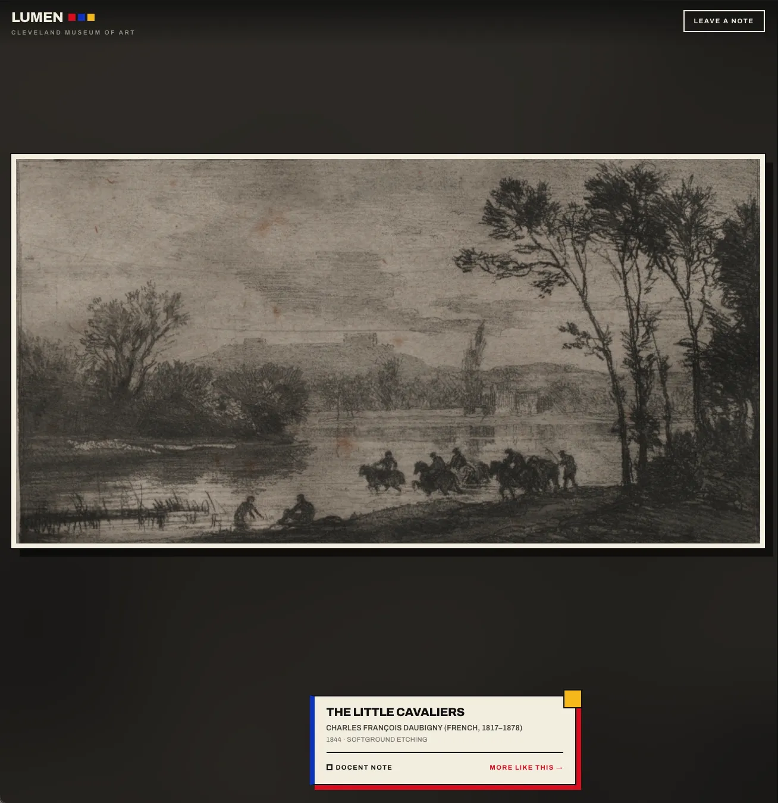

# Lumen

An endless gallery, in the primary colours of a De Stijl poster.

**Live: https://lumen.rafathossain.com**



An endless scroll through the Cleveland Museum of Art's open collection, one artwork per screen. The feed is restricted to fine art (painting, sculpture, drawing, print, photograph, portrait miniature and tapestry), leaving out the ceramics, armour, furniture and jewellery the museum also catalogues. Tap a work to open it full-screen, then pinch, double-tap or scroll to zoom. Double-tap a work you like and the gallery hangs more from the same genre; scroll past them untapped and it drifts back to random. Every work comes with an AI-written docent note.

## Stack

- React 18, Vite 6, Tailwind 4, Motion
- Cloudflare Pages, two Pages Functions (`/api/describe`, `/api/contact`), Workers KV
- No auth, no database
- Only paid dependency is OpenAI, capped by a write-once cache, per-IP rate limits and a budget cap

## Setup

```bash
npm install
cp .dev.vars.example .dev.vars   # add your OpenAI key
```

## Run

Two terminals. Wrangler serves the functions, Vite serves the app:

```bash
npm run dev:functions   # functions on :8788
npm run dev             # app on :5173
```

## Deploy

- Cloudflare Pages: build `npm run build`, output `dist`, or `npm run cf:deploy`
- Bind the `LUMEN_KV` namespace
- `npx wrangler pages secret put OPENAI_API_KEY`
- Set a monthly budget cap in the OpenAI dashboard

---

Artwork and metadata from the [Cleveland Museum of Art Open Access API](https://openaccess-api.clevelandart.org/), CC0. The feed moved off the Art Institute of Chicago in December 2025, when its image host began returning 403 to cross-origin requests. Docent notes are AI-generated and may be inaccurate.
